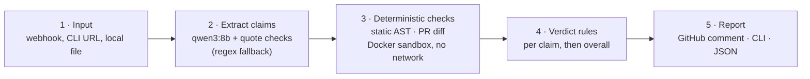
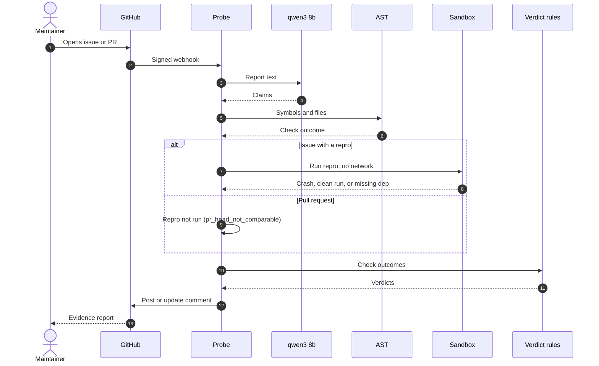
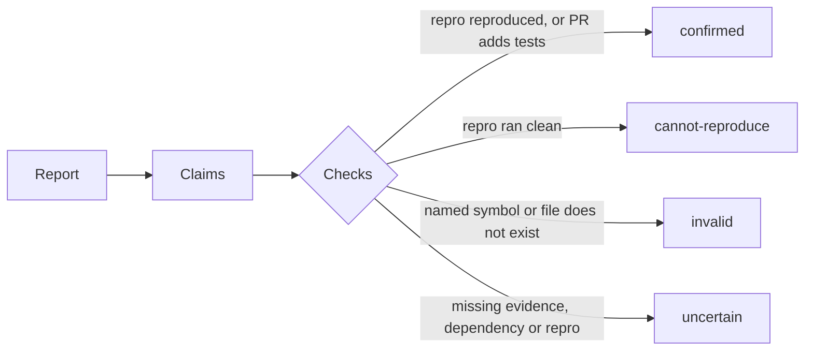

<div align="center">



<br/>

[](https://github.com/ashuwuin/Probe/actions/workflows/ci.yml)
[](https://www.python.org/)
[-8A2BE2.svg?logo=ollama&logoColor=white)](https://ollama.com/library/qwen)
[](https://www.docker.com/)
[](LICENSE)
[](HACKATHON.md)

<p align="center">
  <i>Deterministic AST Lookups · Zero-Network Docker Sandbox · Verbatim Quote Anchoring · Local LLM Extraction</i>
</p>

[Architecture](#-architecture--pipeline) •
[Interactive Workflow](#-interactive-workflow) •
[Verdict Matrix](#-verdict-matrix) •
[Security Model](#-hardened-security-guarantees) •
[Quickstart](#-quickstart--prerequisites) •
[Usage & GitHub App](#-usage) •
[Evaluation Benchmarks](#-evaluation--benchmarks) •
[Known Limitations](#-known-limitations--future-work) •
[Team](#-team--credits)

</div>

---

## 💡 The Problem

Maintainers of popular open-source repositories are inundated with bug reports, security disclosures, and pull requests that contain incorrect, fabricated, or unreproducible claims—a burden amplified by generative AI slop.

**Probe does not attempt to guess whether a human or an AI wrote a report.** Instead, Probe breaks down incoming reports into atomic, testable technical claims, verifies each claim deterministically against the repository code, commit history, AST, PR diffs, and zero-network sandboxed reproductions, and posts evidence-backed verdicts. When evidence is insufficient or dependencies are missing, Probe clearly communicates **uncertainty** rather than hallucinating answers.

---

## 🏛 Architecture & Pipeline



### Core Design Principle: The LLM Extracts, Deterministic Code Decides

Large Language Models excel at natural language parsing but are inherently prone to hallucinations. Asking an LLM whether a bug exists produces unverified opinions. Probe uses the open-weight model **`qwen3:8b`** strictly to parse prose into structured claims (`symbol_exists`, `bug_behavior`, `security_vuln`, `pr_fixes_issue`, `pr_adds_tests`, `version_affected`).

Every verdict is computed by deterministic Python code:
1. **Static AST Analysis (`probe.verify.static`)**: Checks whether claimed functions, classes, and files exist in the AST without executing code. Accurately maps installed package tracebacks (`site-packages/<pkg>/...`) back to repo sources.
2. **PR Diff Verification (`probe.verify.pr_diff`)**: Inspects git diffs to verify if claimed tests were added and whether modifications intersect the reported bug paths.
3. **Isolated Sandbox (`probe.verify.sandbox`)**: Executes claimed reproduction scripts in a zero-network Docker container to verify whether crashes or assertions reproduce.
4. **Deterministic Truth Table (`probe.verdict`)**: Maps evidence outcomes to final verdicts. Supporting claims (like symbol existence) alone can never confirm a bug; invalid verdicts require strict contradictions.

---

## ⚡ Interactive Workflow



<div align="center">
  
  <p><i>Illustrative terminal walkthrough of a confirmed bug reproduction (matching <a href="examples/outputs/01_confirmed_bug.md">examples/outputs/01_confirmed_bug.md</a>)</i></p>
</div>

---

## ⚖️ Verdict Matrix



| Verdict | Badge | Deterministic Trigger | Maintainer Meaning |
|---|:---:|---|---|
| **Confirmed** | ✅ `confirmed` | Sandbox reproduced claimed crash/assertion error, or PR diff verified added tests for a test claim. | A verified bug reproduction or valid test addition. Ready for triage and fixing. |
| **Cannot Reproduce** | 🚫 `cannot-reproduce` | Repro code executed cleanly with exit code 0 (`ran_clean`) without triggering the claimed failure. | The reporter's script does not fail on the codebase commit. Request reporter clarification. |
| **Invalid** | ❌ `invalid` | AST check proved the claimed symbol or file does not exist in the codebase (`symbol_not_found` / `file_not_found`). | Claim disproved by code evidence (one claim, not necessarily the whole report). The maintainer decides. |
| **Uncertain** | ⚠️ `uncertain` | Missing reproduction steps, external third-party dependencies, timeout, or inconclusive evidence (e.g. `pr_fixes_issue` claims remain uncertain without execution testing). | Probe never guesses when evidence is missing. Accompanied by missing-info hints. |

> [!NOTE]
> **Safety Invariant**: Real bugs are never falsely labelled `invalid`. Probe enforces a strict **0 false invalid** rule across all evaluation benchmarks.

---

## 🔒 Hardened Security Guarantees

Probe is designed to run untrusted community-submitted code without endangering host infrastructure:

- **Zero-Network Sandboxed Execution**: All reproduction code runs inside isolated Docker containers with `--network none`, a read-only repository mount, non-root user (`65534:65534`), memory limit (512 MB), process limits (128 PIDs), and a 15-second wall-clock timeout.
- **Prompt Injection Defense**: Issue and PR text is wrapped in data delimiters (`<<<BEGIN_REPORT>>> ... <<<END_REPORT>>>`) and internal delimiter attempts are sanitized. The model has no tool-calling capabilities and its output is strictly validated against a Pydantic JSON schema.
- **Quote & Symbol Anchoring**: Every extracted claim must anchor to an exact character sequence quoted from the original report. Claimed symbols, files, and expected error types are verified to appear verbatim in the reporter's text.
- **Untrusted Repro Sandbox Protection**: For issues, sandboxed Docker execution runs automatically only when opened by repository maintainers (`OWNER`, `MEMBER`, or `COLLABORATOR`). Issues opened by external contributors run static checks only, preventing unauthorized compute usage. Maintainers can explicitly authorize sandbox execution by commenting `/probe rerun` (on PRs, repro execution is skipped per PR #18 semantics).
- **Comment Hijacking Prevention**: When updating triage reports on GitHub, Probe checks for a hidden marker (`<!-- probe-report -->`) and validates bot authorship to prevent editing unauthorized comments.
- **Zero Secrets**: Secrets and tokens are kept in `.env` (gitignored) and never mounted into execution containers.

---

## 🚀 Quickstart & Prerequisites

### Prerequisites
- **Python 3.11+**
- **Docker** or **Colima** (for sandboxed reproduction)
- **Ollama** with **`qwen3:8b`** (local open-weight runtime)

### 1. Clone & Install Dependencies
```bash
git clone https://github.com/ashuwuin/Probe.git
cd Probe

python3.11 -m venv .venv
source .venv/bin/activate
pip install -r requirements.txt
pip install -e .
```

> [!TIP]
> Installing with `pip install -e .` registers the `probe` CLI command globally within your virtual environment, so you can run `probe triage ...` directly.

### 2. Pull Local Model & Docker Sandbox Image
```bash
# Pull open-weight Qwen model via Ollama
ollama pull qwen3:8b

# Pull lightweight Python runner image for sandbox
docker pull python:3.11-slim
```

---

## 💻 Usage

### 1. Triaging directly from a GitHub URL

You can triage an issue or PR directly by passing its GitHub URL. Probe automatically fetches the report body, git diffs, and downloads/caches an immutable repository snapshot pinned to the exact commit:

```bash
# Triage an issue URL and print the Markdown report:
probe triage https://github.com/owner/repo/issues/42 --markdown

# Triage a Pull Request URL:
probe triage https://github.com/owner/repo/pull/101 --markdown

# Post or update the report comment directly on GitHub (requires GITHUB_TOKEN):
probe triage https://github.com/owner/repo/issues/42 --post
```
*(You can also use `PYTHONPATH=src python -m probe.cli triage ...`)*

<details>
<summary><b>📁 Triaging Local Files &amp; Offline Mode (Click to expand)</b></summary>

<br/>

#### Triaging an Issue File Locally
```bash
probe triage issue_report.txt \
  --repo /path/to/repo \
  --issue \
  --repo-name owner/repo \
  -n 42 \
  --markdown
```

#### Triaging a Pull Request Locally
```bash
probe triage pr_description.txt \
  --repo /path/to/repo \
  --pr \
  --diff pr_changes.diff \
  --repo-name owner/repo \
  -n 101 \
  --markdown
```

#### Offline / CI Mode (No LLM Required)
Run with `--no-llm` to use the deterministic AST and regex extraction fallback:
```bash
probe triage issue_report.txt --repo . --issue --no-llm --markdown
```

</details>

---

### 2. Running as a GitHub App (Automated Webhook Triage)

Probe can run as an automated GitHub App server that listens to webhook events, triages new issues and pull requests in real time, and posts evidence comments:

```bash
# Start the webhook server on port 8000:
probe serve --port 8000
```

- **Supported Webhook Events**: Automatically triages on `issues.opened`, `issues.edited` (when body content changes), and `pull_request.opened` / `pull_request.synchronize`.
- **Interactive Commands**: Responds to `/probe rerun` comments posted on issues and PRs (allowed for maintainers—`OWNER`, `MEMBER`, `COLLABORATOR`—or the issue's author; only a maintainer's rerun runs an issue's repro in the Docker sandbox, and PR repros are never run).
- **Environment Configuration** (`.env`):
  - `GITHUB_APP_ID`, `GITHUB_WEBHOOK_SECRET`, `GITHUB_PRIVATE_KEY` / `GITHUB_PRIVATE_KEY_PATH`
  - `PROBE_APPLY_LABELS`: Automatically applies GitHub labels matching verdicts (e.g. `triage:confirmed`, `triage:invalid`, `triage:cannot-reproduce`, `triage:uncertain`). Off by default (`false`).
  - `PROBE_MAX_CONCURRENT_JOBS`: Concurrency limit for background triage worker jobs.

For complete setup, permissions, and deployment guides, see [`docs/GITHUB_APP.md`](docs/GITHUB_APP.md) and [`docs/ARCHITECTURE.md`](docs/ARCHITECTURE.md).

---

## 🔎 Real Evidence Report Output

Below is an authentic evidence report generated by Probe against a synthetic vulnerability report (`owner/repo#42`):

```markdown
<!-- probe-report -->
### 🔎 Probe evidence report: [owner/repo#42](https://github.com/owner/repo/issues/42) *(synthetic)*

**Overall:** ❌ **Invalid** (high confidence)

Checked 1 claim: ❌ **Invalid** 1

| # | Claim | Verdict | Evidence |
|---|---|---|---|
| `c1` | "`parse_url_v2()` in `src/requests/utils.py` does not strip the userinfo part of proxy URLs before logging them" | ❌ **Invalid** (high) | Symbol `parse_url_v2` was not found in `src/requests/utils.py`. |

--------

Claims extracted by `qwen3:8b` running locally (Ollama).  
ℹ️ Automated, evidence-based triage by Probe. Verdicts come from code checks, not from the AI model. A maintainer makes the final call.
```

---

## 📊 Evaluation & Benchmarks

Probe is evaluated against real closed issues and pull requests from major open-source projects including [Loguru](https://github.com/Delgan/loguru), [Poetry](https://github.com/python-poetry/poetry), [Rich](https://github.com/Textualize/rich), and [Textual](https://github.com/Textualize/textual), as well as a checkable group of symbol AST, PR diff, and sandboxed test cases.

- Detailed methodology and benchmark results: see [`eval/RESULTS.md`](eval/RESULTS.md).
- Real scenario inputs and outputs: see [`examples/`](examples/).

| Group | Cases | Decided Coverage | Accuracy on Decided | Wrong `invalid` Verdicts |
|---|:---:|:---:|:---:|:---:|
| **Checkable Cases** | 5 | 5/5 (100%) | **5/5 (100%)** | **0** |
| **Maintainer-Labelled Issues** | 12 | 0/12 (0%) | n/a (stops at `uncertain`) | **0** |
| **Total / Combined** | 17 | 5/17 (29%) | 5/5 (100%) | **0 observed on 17 cases** |

### Evaluation Principles & Sandbox Dependency Notes:
- **Zero False `invalid` Verdicts**: Real bugs are never falsely labelled invalid.
- **No Decisive Verdict Without Evidence**: Every non-uncertain verdict requires concrete AST or execution evidence.
- **Sandbox Network & Dependency Isolation**: Probe runs reproduction snippets inside a hardened zero-network container (`--network none`) based on `python:3.11-slim`. Most real-world bug reports lack self-contained reproduction scripts entirely (reporters describe behavior or paste logs without runnable code, yielding `no_applicable_check`), and the few with reproduction scripts require external third-party dependencies not present in the clean base image (e.g. rich-2988 hitting `missing_dependency`). Because Probe disables network access at triage time to prevent SSRF and token leakage, these cases safely stop at `uncertain` rather than guessing. To evaluate deterministic decision logic with ground truth, Probe's benchmark includes a **checkable cases** group covering symbol AST checks, PR test additions/omissions, and self-contained demo reproductions.
- **Gold vs. LLM Extraction (`qwen3:8b`)**: Evaluated in [`eval/EXTRACTION.md`](eval/EXTRACTION.md), showing 17/17 identical issue-level verdicts, 44 extracted claims vs. 19 gold claims, and detailed recall/precision metrics.
- **Panel Q&A & Evaluation Defenses**: See [`docs/ARCHITECTURE.md#11-panel-qa-and-evaluation-defenses`](docs/ARCHITECTURE.md#11-panel-qa-and-evaluation-defenses) for comprehensive technical explanations of real sandbox bug confirmations, infinite loop timeouts, dependency isolation, and non-Python repository safety.

---

## ⚠️ Known Limitations & Future Work

- **Real-world repros usually need the project's dependencies.** Most real reports lack runnable repro scripts, and those that include snippets often need third-party packages not pre-installed in `python:3.11-slim` (stopping at `uncertain: missing_dependency`). Planned: per-project environment images, built once with network access for chosen benchmark repos and then used with `--network none` for every check. These would never be built automatically for arbitrary repositories, because installing a package runs untrusted code.
- **Repros in pull requests are not executed.** On a PR the snapshot is the PR's own changed code, so a clean run would mean "the fix works", not "cannot reproduce", and a crash may be a broken fix. These are reported as `inconclusive` until a base-vs-head comparison exists.
- **Python first.** JS/TS/Rust/Go only get regex-based "does this definition exist" hints.

---

## 👥 Team & Credits

**Team Zig1** · *Problem 2 (NST × Rishihood University Hacktoberfest Hack Day 2026)*

- **Ashwin Anand** ([@ashuwuin](https://github.com/ashuwuin)) — Integration, CI/scaffolding, sandbox execution, CLI
- **Kaashvi Saini** ([@Kaashviw3spaces](https://github.com/Kaashviw3spaces)) — AI claim extraction (`qwen3:8b`), guardrails, Markdown reporting
- **Prachi Vats** ([@Prachivats-21](https://github.com/Prachivats-21)) — Static code checkers, AST symbol verification, evaluation suite & GitHub client

### Models & Tools
- **Runtime Model**: `qwen3:8b` via local Ollama (Apache-2.0 open weights). No closed or cloud AI APIs are used.
- **AI Coding Assistants**: Gemini AGY (Antigravity), Claude Code.

---

## 📄 License

This project is open-source under the [MIT License](LICENSE).
